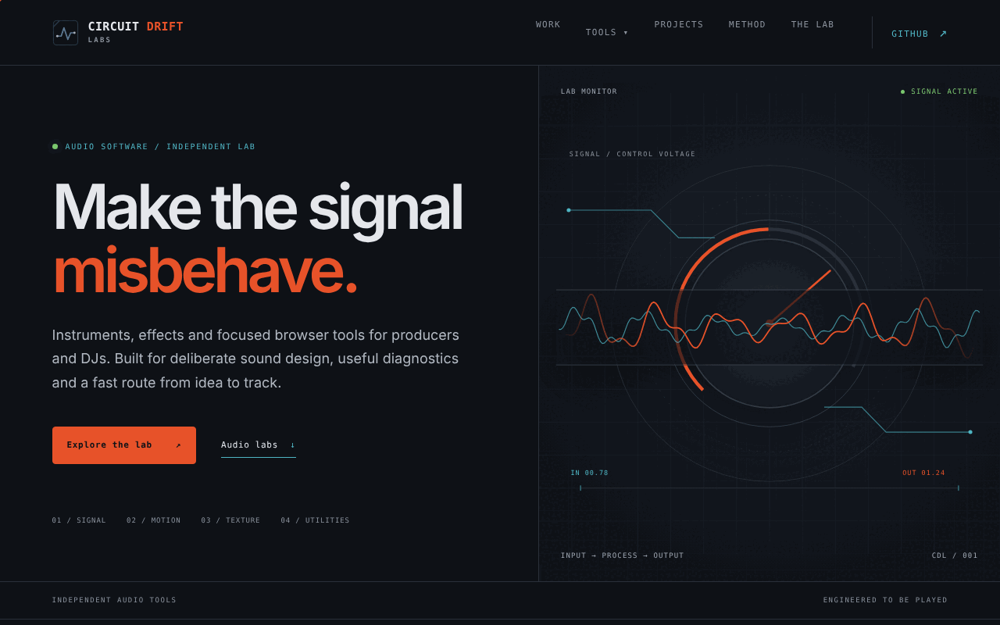
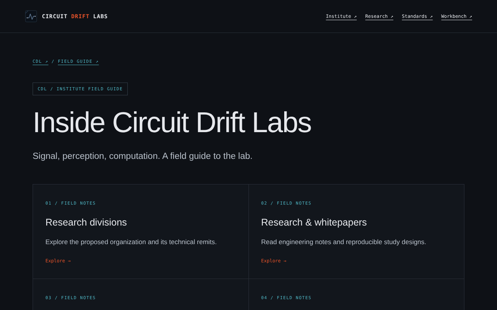
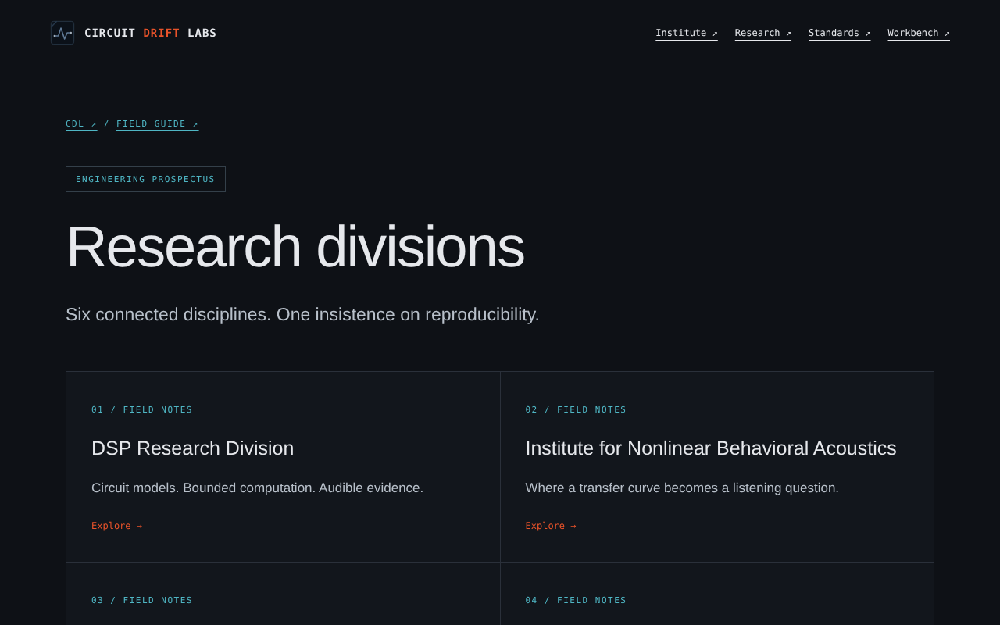

# Circuit Drift Labs

Circuit Drift Labs is a static GitHub Pages site for open-source audio tools, instruments, effects and browser utilities for producers and DJs.

Live site: https://djshellshoxxx.github.io/circuitdriftlabs/

## Screenshots







_Captured at 1280x800 from a local static server. Note: the institute-area pages (`institute/`, `divisions/`, `research/`, `standards/`, etc.) reference assets with a `/circuitdriftlabs/` path prefix, so serve the repo from a parent directory to preview them correctly (see below)._

## Browser tools

The homepage includes a persistent **Tools** dropdown and dedicated browser-tools section linking the current utility suite:

- TrackStats — local music-library analytics
- Transposition Calculator — key, pitch, BPM and sample calculations
- MIDItest — MIDI monitoring and controller diagnostics
- LoudnessBatch — batch loudness/reference analysis
- PartyPosterGen — fast rave, DJ and party-poster creation

The homepage also features seven **Audio labs** (Binaural Web Beats, 3xOSO, Terrain Loom / WebSynth, BabbleForge, BrowserToneGen, VisualSynth, Auditory Illusion Laboratory).

## Complete audio project index

The homepage includes a single project index linking every verified audio-related repository in the Circuit Drift Labs ecosystem, plus live GitHub Pages builds where they are known to exist.

Repositories currently indexed:

- trackstats
- TranspositionCalc
- Miditest
- loudnessbatch
- browsertonegen
- binauralwebeats
- babbleforge
- pluginchek
- websynth
- 3xoso
- visualsynth
- luthier
- shelloop
- snaircreator
- robodrummer
- ReverseVerb
- interfearance-vst
- reverseback
- groovescripting
- AUDIO-COMMAND-LINE-TOOLS
- SideForge
- GapFill
- PartyPosterGen
- Auditory-Illusion-Laboratory

## Site design

The site uses a dark technical workbench aesthetic with a compact Circuit Drift Labs mark. The current mark uses dark blue, black and gray rather than the earlier orange/teal icon treatment, while the rest of the existing typography and site structure are preserved.

Everything is static: no package manager, framework, build step or account system is required.

## Preview locally

```bash
python -m http.server 8000
```

Then open `http://localhost:8000`. Pages under `institute/`, `divisions/`, `research/`, `standards/`, `history/`, `culture/` etc. load CSS/icons from `/circuitdriftlabs/...`, so to preview them locally expose the repo under that path:

```bash
mkdir -p /tmp/serve && ln -sfn "$PWD" /tmp/serve/circuitdriftlabs
cd /tmp/serve && python3 -m http.server 8000   # open http://localhost:8000/circuitdriftlabs/
```

There is no automated test suite; verify changes by loading pages in a browser.

## Adding releases

Edit `products.js` to add published plugin/instrument releases. Browser utilities are maintained separately in the Tools section in `index.html` so they remain clearly distinguished from instruments/effects.

## Project layout

- `index.html`, `styles.css`, `tools.css`, `site.js`, `products.js` — homepage, styles, Tools dropdown and optional release cards
- `institute/`, `divisions/`, `research/`, `standards/`, `history/`, `culture/`, `facilities/`, `affiliations/`, `case-studies/`, `the-workbench/` — the "Inside CDL" institute section (HTML pages, some with Markdown sources alongside); styled by `assets/institute.css`
- `assets/` — SVG drawings, mark, and `photos/` (see `assets/photos/CREDITS.md`)
- `tools/generate_art.py` — regenerates the SVG drawings in `assets/`
- `shared/scripts/` — Python/shell helpers for JUCE plugin projects (release builds, version bumps, Sparkle/WinSparkle update setup, project scaffolding)
- `ideas/` — mobile-sovereignty product concept notes
- `skills/`, `.github/agents/` — AI-assistant skills and the feature-auditor agent (third-party licences in `skills/_third_party_licenses/`)
- `docs/superpowers/specs/` — ecosystem design specs; `docs/screenshots/` — README images
- `BRAND.md`, `theme.md`, `COPYRIGHT-TRADEMARK.md` — brand, visual identity and trademark notes
- `sitemap.xml`, `social-preview.png`, `.nojekyll` — SEO/sharing and direct GitHub Pages serving

## License

See `LICENSE`: brand materials, copy and graphics are all rights reserved; code is reusable only where a file or directory expressly grants an open-source licence.

## Related repositories

- https://github.com/djshellshoxxx/trackstats
- https://github.com/djshellshoxxx/TranspositionCalc
- https://github.com/djshellshoxxx/Miditest
- https://github.com/djshellshoxxx/loudnessbatch
- https://github.com/djshellshoxxx/PartyPosterGen

The project remains open-source-focused. Before commercial use of branding, perform the appropriate domain/trademark checks for the relevant markets.
